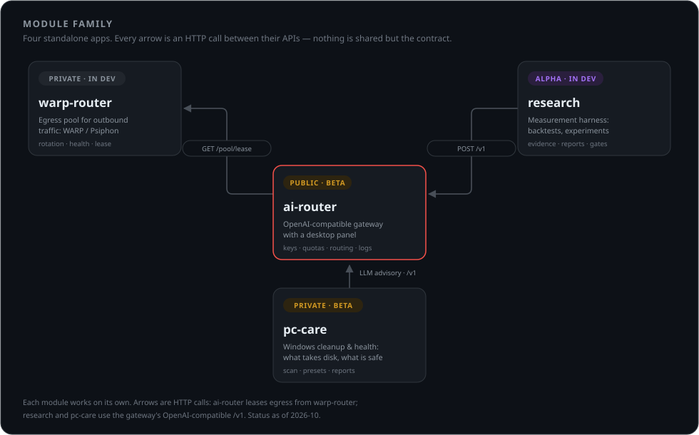
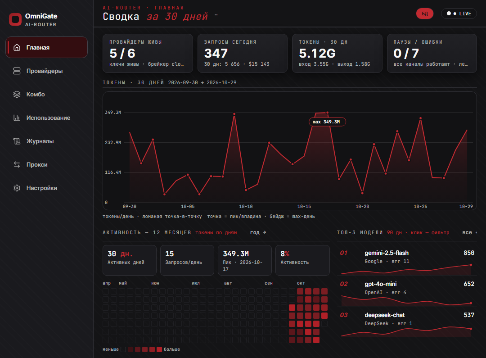
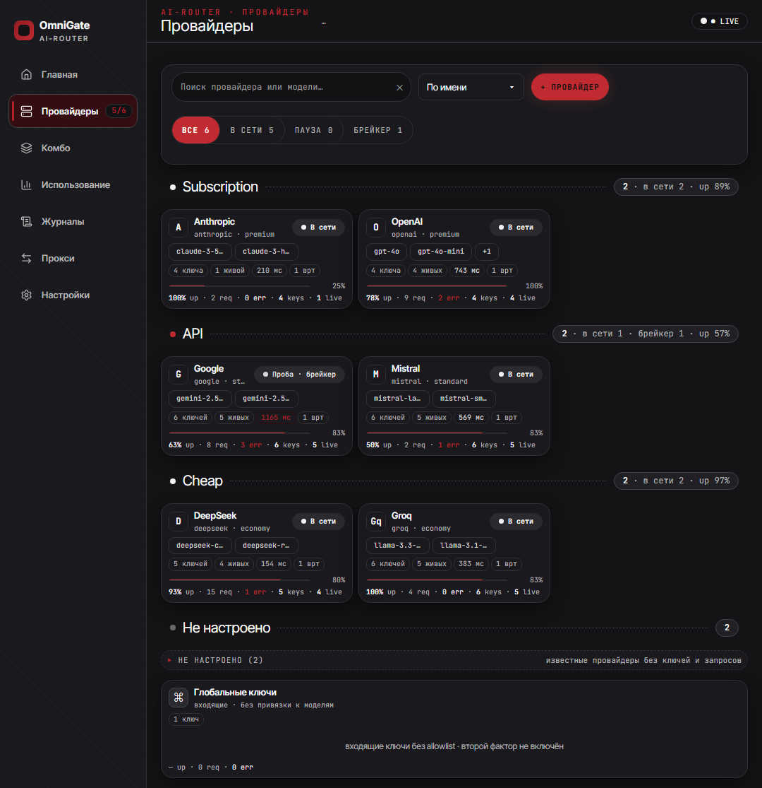
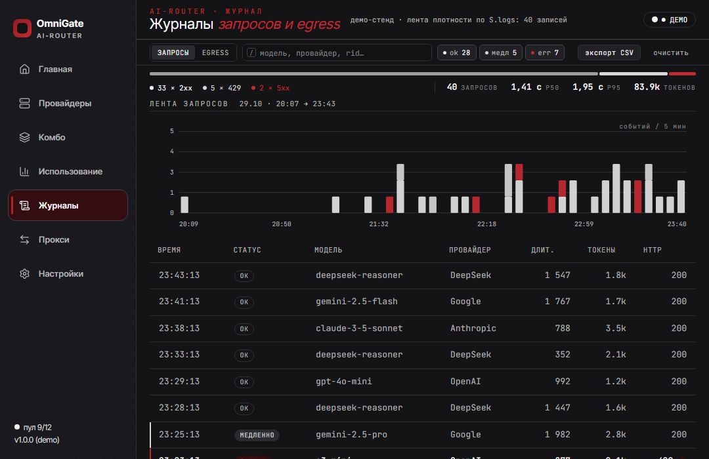
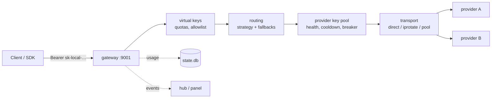

# ai-router

**English** · [Русский](README.ru.md)

[](https://github.com/ByJotaro/ai-router/actions/workflows/ci.yml)
[](go.mod)
[](LICENSE)
[](https://github.com/ByJotaro/ai-router/issues)

> ### ⚠️ Beta
>
> ai-router is under active development. The visuals of **every panel tab** and
> parts of the functionality are being reworked right now, so screens and
> behaviour can change between commits. Expect rough edges.
>
> **Ideas, bug reports and feature requests are very welcome — please
> [open an Issue](https://github.com/ByJotaro/ai-router/issues).** UI sketches,
> provider quirks, routing ideas, error logs: anything that helps the project
> move forward is useful.

ai-router is **one of several modules**. Each module is a standalone
application, but they speak the same API language: connect them through their
API gateways (HTTP, OpenAI-compatible endpoints, the hub module protocol) and
they share routing, key pools, egress and telemetry. Nothing is required —
every module is useful on its own.



| Module | Status | What it does |
|---|---|---|
| **ai-router** | Public · beta | OpenAI-compatible gateway with a desktop control panel |
| **warp-router** | Private · in development | Egress pool: WARP/Psiphon rotation, health, lease API |
| **research** | Alpha · in development | Measurement harness: backtests, experiments, evidence |
| **pc-care** | Private · beta | Windows cleanup and health: what takes disk, what is safe to remove |



## What it is

A self-hosted OpenAI-compatible gateway for many LLM providers with a desktop
control panel. Point any OpenAI SDK at `http://127.0.0.1:9001/v1` and get one
endpoint for all your providers: key pools, quotas, fallback routing, streaming,
logs and usage charts.

Single Go binary (GUI included), no external services: `config.yaml` and a local
SQLite `state.db`. Windows 10/11 + WebView2.

## Features

- **OpenAI-compatible API** — `POST /v1/chat/completions` (SSE streaming,
  `tools`/`tool_calls`, `usage`), `POST /v1/responses`, `GET /v1/models`;
  errors in the `{"error":{"message","type","code"}}` shape.
- **Providers** — `openai-compatible` type (`base_url` + `api_keys[]` + `models`
  + `fallbacks`), tiers (subscription / api / cheap / free), cost accounting.
- **Key pools** — least-used and round-robin, health tracking, cooldown, breaker,
  rotation on `401`/`429`, temporary disable after repeated failures.
- **Virtual keys** — your own keys with token/request quotas and a model
  allowlist; usage and request log live in SQLite `state.db`; exhausted quota
  returns `429`.
- **Routing** — `priority | weighted | round-robin | p2c | cost | lkgp` plus a
  fallback chain across providers and models.
- **Transport** — `direct`, `iprotate` (fan-out over several IPs on `429`) and
  `pool` (egress pool with cooldown); optional `egress` proxy module.
- **Combo presets** — several providers behind one virtual model name.
- **Control panel** — 7 tabs: Home, Providers, Combos, Usage, Logs, Proxies,
  Settings. Dark theme, tray, demo mode `?demo=1` with no live data.
- **Observability** — ring log, request and egress event log, token charts,
  activity calendar, provider and key health.
- **Hub module** — registration in a hub, actions `chat.complete/test/usage`,
  events.

## Screenshots

**Providers** — pools, breakers, tiers, key health:



**Logs** — requests, egress events, filters:



All screenshots are taken at the panel's default width (1080 px). Heights
differ: Home and Providers are taller than the 700 px launch window so the whole
page fits, Logs keeps the default 700 px.

## Requirements

- Windows 10/11 x64 (WebView2 Runtime ships with the system)
- Go 1.24+
- [wails CLI v2.12+](https://wails.io) — only to build the GUI
- Node 20 — not needed: the frontend ships prebuilt in `internal/gui/frontend/dist`

## Build

```powershell
# GUI (panel + daemon in one exe)
go install github.com/wailsapp/wails/v2/cmd/wails@v2.12.0
cd cmd/ai-router
wails build -tags desktop,production -skipbindings
# -> cmd/ai-router/build/bin/ai-router.exe

# CLI/daemon only, no GUI (from the repository root)
cd ../..
go build -o ai-router.exe ./cmd/ai-router
```

## Quick start

```powershell
# 1. config
copy config.example.yaml "$env:LOCALAPPDATA\ai-router\config.yaml"
#    (or generate one from opencode: go run ./cmd/import-opencode)

# 2. start (daemon + panel window; --cli for headless)
.\ai-router.exe serve

# 3. admin_token is generated on first start — read it from config.yaml
$token = (Select-String -Path "$env:LOCALAPPDATA\ai-router\config.yaml" -Pattern '^admin_token:\s*(\S+)').Matches[0].Groups[1].Value

# 4. call the gateway (admin_token is accepted as a full-access Bearer)
curl http://127.0.0.1:9001/v1/chat/completions `
  -H "Authorization: Bearer $token" `
  -H "Content-Type: application/json" `
  -d '{"model":"gpt-4o-mini","messages":[{"role":"user","content":"hello"}]}'
```

## Add a provider

A provider is a `base_url` plus one or more keys. Add it to `config.yaml` and
restart the daemon (the panel writes the same file):

```yaml
providers:
  deepseek:
    type: openai-compatible
    base_url: https://api.deepseek.com/v1
    api_keys: [sk-...]          # several keys = one pool
    models: [deepseek-chat, deepseek-reasoner]
    fallbacks: [openrouter]     # tried when this provider is down
    timeout_s: 120
```

A keyless public endpoint uses `api_keys: []` + `auth_mode: none`. After saving,
`ai-router providers` shows the provider, its key count and model list — keys
are never printed.

## Virtual keys

Clients use your own keys, not provider keys. Quota `0` means unlimited, an
empty `models` list means all models:

```yaml
keys:
  - name: home
    key: sk-local-...
    quota_tokens: 1000000
    quota_reqs: 100
    models: [high-availability]
```

## CLI

```text
ai-router serve                 # daemon + panel (default)
ai-router serve --cli           # headless: no tray, no window, logs to stdout
ai-router status                # summary: address, providers, models, keys, hub
ai-router providers             # providers + key counts (keys are never printed)
ai-router keys                  # virtual keys: usage/quotas (masked)
ai-router models                # models: provider -> list
ai-router usage                 # usage per key
ai-router routes                # breaker/lockout/routing state
ai-router config                # config with secrets masked
ai-router doctor                # diagnostics: config, token, providers, models, keys, store
ai-router test [-model X]       # live test request through the first working provider
```

Common flags: `-c/--config path`, `--json` (for `status/models/usage/routes/config/doctor`),
`--version`, `--help`. `serve` flags: `--cli`, `--egress`, `--no-autostart`, `--minimized`.

## Configuration

File: `%LOCALAPPDATA%\ai-router\config.yaml`, full example in [`config.example.yaml`](config.example.yaml).

| Section | Purpose |
|---|---|
| `server` | gateway address and port, log level |
| `admin_token` | full access to the panel/API (generated automatically) |
| `providers.<name>` | type, `base_url`, `api_keys[]`, `models`, `fallbacks`, `transport`, `timeout_s` |
| `keys[]` | virtual keys: quotas and model allowlist |
| `resilience` | breaker, cooldown, lockout |
| `routing` | strategy, `tiers`, cost accounting |
| `encryption` | `enc:v1` key (`STORAGE_ENCRYPTION_KEY`) for keys stored in state |
| `egress` | proxy pool through the `egress` module (optional) |
| `hub` | hub registration: URL, module token, listen address |

Provider transport modes:

```yaml
transport:
  mode: direct        # direct | iprotate | pool
  fanout: 5           # iprotate: parallel attempts
  rounds: 2
  cooldown_s: 30
```

## API

| Method | Path | Description |
|---|---|---|
| `GET` | `/v1/models` | model list (virtual and provider models) |
| `POST` | `/v1/chat/completions` | chat, SSE streaming, `tools`, `usage` |
| `POST` | `/v1/responses` | OpenAI Responses API |

Streaming example:

```powershell
curl -N http://127.0.0.1:9001/v1/chat/completions `
  -H "Authorization: Bearer sk-local-..." `
  -H "Content-Type: application/json" `
  -d '{"model":"high-availability","stream":true,"messages":[{"role":"user","content":"2+2"}]}'
```

## How it works



The request is resolved once — key, model, provider, key slot — and then
streamed through unchanged, so `tools`, `tool_calls`, `reasoning_content` and
provider-specific fields survive the hop. Everything the panel shows comes from
the same `state.db` the daemon writes.

## Project layout

```text
cmd/ai-router/           daemon: OpenAI :9001 + hub module + GUI + CLI
cmd/import-opencode/     import providers/keys from opencode
cmd/fake-upstream/       fake OpenAI server for e2e
internal/config/         config.yaml + state.db (SQLite), paths and migrations
internal/provider/       provider abstraction (openai-compatible, oauth)
internal/pool/           key pools: least-used, disable, 401/429 rotation
internal/gateway/        OpenAI-compatible server + OpenAI-shaped errors
internal/stream/         SSE passthrough + conversion + usage
internal/keys/           virtual keys: quotas, usage (state.db)
internal/route/          model→provider routing, fallback, transport/egress
internal/gui/            panel (Wails + vanilla JS, dist bundled)
internal/hubmod/         hub module: registration, actions, events
internal/logring/        ring log
scripts/e2e.ps1          end-to-end check
docs/compose/spec/       historical module spec
```

## Tests

```powershell
go test ./...
```

End-to-end (optional): `scripts/e2e.ps1` starts fake upstreams and the daemon on
isolated ports and checks models, chat (non-stream and stream with `[DONE]` and
`usage`), fallback, tools, 401/404/429 codes and hub registration. It needs a
local hub (`AI_ROUTER_HUB_TOKEN`, `hub.exe` via `AI_ROUTER_HUB_EXE` or `-HubExe`)
and stops only the processes it started. Without a hub, `go test ./...` already
covers the gateway.

## Troubleshooting

| Symptom | What to check |
|---|---|
| `401 invalid api key` from a client | the Bearer is a **virtual key** (`keys[]`) or `admin_token`, not a provider key |
| `404 model not found` | the model is not listed in any `providers.<name>.models` and is not a combo name |
| `429 quota exceeded` | virtual key quota (`quota_tokens` / `quota_reqs`); `ai-router keys` shows the rest |
| all providers `down` | `ai-router routes` — breaker state; `ai-router test` sends one live request |
| the panel is blank | WebView2 Runtime missing or broken — install the Evergreen runtime from Microsoft; `doctor` does not check it |
| port 9001 busy | another daemon is already running: `ai-router status`; change `server.port` in `config.yaml` (`serve` has no `--port` flag) |

`ai-router doctor` prints the config path, the listen address, provider and key
counts and the store path, with secrets masked — paste it into an issue instead
of the config.

## Security

- `admin_token` and provider keys are never printed to logs or CLI (masked).
- Keys in `state.db` can be stored as `enc:v1` (AES-GCM, key from `STORAGE_ENCRYPTION_KEY`).
- The gateway listens on `127.0.0.1` by default — do not expose it to the internet
  without a TLS proxy.
- Nothing leaves the machine except requests to the provider you configured: no
  telemetry.

## Legal

This project is a neutral gateway. Provider terms of service (OpenAI, Anthropic,
Google, DeepSeek and others) remain yours: use your own keys and plans, respect
rate limits. Free/trial lanes and transport modes that work around rate limits
are included as an experiment and are not a permission to break provider rules.

## Contributing

The project is in beta and moves fast. The most useful contributions right now:

- **Ideas and UX feedback** — especially about the panel: what is confusing, what
  is missing, what a tab should show.
- **Bug reports** — steps, config section (secrets masked), and the log excerpt
  from the Logs tab.
- **Provider notes** — quirks of specific providers/models (auth, streaming,
  tool calls, rate limits).

Issues in English or Russian are equally fine. There is no heavy process: open an
issue, describe the case, and we will figure it out together.

The project is dual-licensed (AGPL-3.0 for everyone, a commercial license for
closed use), so contributions are accepted under the project license **with the
right to relicense them** — say so in the PR.

## License

[AGPL-3.0](LICENSE) © 2026 jotaro.

You can use, modify and redistribute ai-router, including commercially, as long
as derivative work stays under the same license and its source is available —
including when the modified program is offered to users over a network. If you
need to embed ai-router in a closed product, a commercial license is available
on request — open an issue with the subject `commercial license`.

The implementation is original: the gateway, the pool and routing logic and the
panel were written for this project. Where behaviour matches other tools, it is
reimplemented from public API documentation and observed protocol behaviour, not
copied — so the repository carries no third-party code or notice files.
