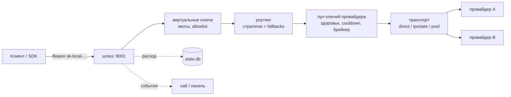

# ai-router

[English](README.md) · **Русский**

[](https://github.com/ByJotaro/ai-router/actions/workflows/ci.yml)
[](go.mod)
[](LICENSE)
[](https://github.com/ByJotaro/ai-router/issues)

> ### ⚠️ Бета
>
> ai-router активно развивается. Прямо сейчас переделываются визуалы **всех
> вкладок** панели и часть функционала, поэтому экраны и поведение могут
> меняться от коммита к коммиту. Шероховатости ожидаемы.
>
> **Идеи, баг-репорты и пожелания очень нужны — заводите
> [Issue](https://github.com/ByJotaro/ai-router/issues).** Наброски интерфейса,
> особенности провайдеров, идеи роутинга, логи ошибок: полезно всё, что двигает
> проект вперёд.

ai-router — **один из нескольких модулей**. Каждый модуль это самостоятельное
приложение, но они говорят на одном языке API: соедините их через их же
API-шлюзы (HTTP, OpenAI-совместимые эндпоинты, протокол модулей хаба) — и они
делят маршрутизацию, пулы ключей, egress и телеметрию. Ничего не обязательно:
каждый модуль полезен сам по себе.


| Модуль | Статус | Что делает |
|---|---|---|
| **ai-router** | Публичный · бета | OpenAI-совместимый шлюз с настольной панелью управления |
| **warp-router** | Приватный · в разработке | Пул egress: ротация WARP/Psiphon, здоровье, lease-API |
| **research** | Альфа · в разработке | Измерительный стенд: бэктесты, эксперименты, доказательства |
| **pc-care** | Приватный · бета | Чистка и здоровье Windows: что занимает диск, что можно удалять |


## Что это

Самостоятельно размещаемый OpenAI-совместимый шлюз для множества
LLM-провайдеров с настольной панелью управления. Направьте любой OpenAI SDK на
`http://127.0.0.1:9001/v1` — и получите одну точку для всех провайдеров: пулы
ключей, квоты, fallback-роутинг, стриминг, журналы и графики расхода.

Один бинарник на Go (GUI внутри), без внешних сервисов: `config.yaml` и
локальная SQLite `state.db`. Windows 10/11 + WebView2.

## Возможности

- **OpenAI-совместимый API** — `POST /v1/chat/completions` (SSE-стриминг,
  `tools`/`tool_calls`, `usage`), `POST /v1/responses`, `GET /v1/models`;
  ошибки в форме `{"error":{"message","type","code"}}`.
- **Провайдеры** — тип `openai-compatible` (`base_url` + `api_keys[]` + `models`
  + `fallbacks`), тиры (subscription / api / cheap / free), учёт стоимости.
- **Пулы ключей** — least-used и round-robin, здоровье, cooldown, брейкер,
  ротация на `401`/`429`, временное отключение после серии ошибок.
- **Виртуальные ключи** — свои ключи с квотами по токенам/запросам и allowlist
  моделей; расход и журнал запросов лежат в SQLite `state.db`; исчерпанная
  квота возвращает `429`.
- **Роутинг** — `priority | weighted | round-robin | p2c | cost | lkgp` плюс
  цепочка fallback по провайдерам и моделям.
- **Транспорт** — `direct`, `iprotate` (веер по нескольким IP на `429`) и
  `pool` (пул egress с cooldown); опциональный прокси-модуль `egress`.
- **Комбо-пресеты** — несколько провайдеров за одним виртуальным именем модели.
- **Панель управления** — 7 вкладок: Главная, Провайдеры, Комбо, Использование,
  Журналы, Прокси, Настройки. Тёмная тема, трей, демо-режим `?demo=1` без живых
  данных.
- **Наблюдаемость** — кольцевой лог, журнал запросов и egress-событий, графики
  токенов, календарь активности, здоровье провайдеров и ключей.
- **Модуль хаба** — регистрация в хабе, действия `chat.complete/test/usage`,
  события.

## Скриншоты

**Провайдеры** — пулы, брейкеры, тиры, здоровье ключей:


**Журналы** — запросы, egress-события, фильтры:


Все снимки — в штатной ширине панели (1080 px). Высота разная: «Главная» и
«Провайдеры» выше окна в 700 px, чтобы страница влезла целиком, «Журналы» —
в штатных 700 px.

## Требования

- Windows 10/11 x64 (WebView2 Runtime уже есть в системе)
- Go 1.24+
- [wails CLI v2.12+](https://wails.io) — только для сборки GUI
- Node 20 — не нужен: фронтенд лежит собранным в `internal/gui/frontend/dist`

## Сборка

```powershell
# GUI (панель + демон в одном exe)
go install github.com/wailsapp/wails/v2/cmd/wails@v2.12.0
cd cmd/ai-router
wails build -tags desktop,production -skipbindings
# -> cmd/ai-router/build/bin/ai-router.exe

# Только CLI/демон, без GUI (из корня репозитория)
cd ../..
go build -o ai-router.exe ./cmd/ai-router
```

## Быстрый старт

```powershell
# 1. конфиг
copy config.example.yaml "$env:LOCALAPPDATA\ai-router\config.yaml"
#    (или сгенерировать из opencode: go run ./cmd/import-opencode)

# 2. запуск (демон + окно панели; --cli для headless)
.\ai-router.exe serve

# 3. admin_token генерируется при первом старте — читаем из config.yaml
$token = (Select-String -Path "$env:LOCALAPPDATA\ai-router\config.yaml" -Pattern '^admin_token:\s*(\S+)').Matches[0].Groups[1].Value

# 4. запрос к шлюзу (admin_token принимается как Bearer с полным доступом)
curl http://127.0.0.1:9001/v1/chat/completions `
  -H "Authorization: Bearer $token" `
  -H "Content-Type: application/json" `
  -d '{"model":"gpt-4o-mini","messages":[{"role":"user","content":"hello"}]}'
```

## Добавить провайдера

Провайдер — это `base_url` плюс один или несколько ключей. Добавьте его в
`config.yaml` и перезапустите демон (панель пишет тот же файл):

```yaml
providers:
  deepseek:
    type: openai-compatible
    base_url: https://api.deepseek.com/v1
    api_keys: [sk-...]          # несколько ключей = один пул
    models: [deepseek-chat, deepseek-reasoner]
    fallbacks: [openrouter]     # пробуются, когда провайдер недоступен
    timeout_s: 120
```

Публичный эндпоинт без ключа: `api_keys: []` + `auth_mode: none`. После
сохранения `ai-router providers` покажет провайдера, число ключей и список
моделей — сами ключи никогда не печатаются.

## Виртуальные ключи

Клиенты ходят со своими ключами, а не с ключами провайдеров. Квота `0` — без
лимита, пустой список `models` — все модели:

```yaml
keys:
  - name: home
    key: sk-local-...
    quota_tokens: 1000000
    quota_reqs: 100
    models: [high-availability]
```

## CLI

```text
ai-router serve                 # демон + панель (по умолчанию)
ai-router serve --cli           # headless: без трея и окна, логи в stdout
ai-router status                # сводка: адрес, провайдеры, модели, ключи, хаб
ai-router providers             # провайдеры + число ключей (ключи не печатаются)
ai-router keys                  # виртуальные ключи: расход/квоты (маскировано)
ai-router models                # модели: провайдер -> список
ai-router usage                 # расход по ключам
ai-router routes                # состояние брейкеров/локов/роутинга
ai-router config                # конфиг с маскированными секретами
ai-router doctor                # диагностика: конфиг, токен, провайдеры, модели, ключи, store
ai-router test [-model X]       # живой тестовый запрос через первого рабочего провайдера
```

Общие флаги: `-c/--config path`, `--json` (для `status/models/usage/routes/config/doctor`),
`--version`, `--help`. Флаги `serve`: `--cli`, `--egress`, `--no-autostart`, `--minimized`.

## Конфигурация

Файл: `%LOCALAPPDATA%\ai-router\config.yaml`, полный пример — [`config.example.yaml`](config.example.yaml).

| Секция | Назначение |
|---|---|
| `server` | адрес и порт шлюза, уровень логов |
| `admin_token` | полный доступ к панели/API (генерируется автоматически) |
| `providers.<name>` | тип, `base_url`, `api_keys[]`, `models`, `fallbacks`, `transport`, `timeout_s` |
| `keys[]` | виртуальные ключи: квоты и allowlist моделей |
| `resilience` | брейкер, cooldown, лок моделей |
| `routing` | стратегия, `tiers`, учёт стоимости |
| `encryption` | ключ `enc:v1` (`STORAGE_ENCRYPTION_KEY`) для ключей в состоянии |
| `egress` | прокси-пул через модуль `egress` (опционально) |
| `hub` | регистрация в хабе: URL, токен модуля, адрес прослушивания |

Режимы транспорта провайдера:

```yaml
transport:
  mode: direct        # direct | iprotate | pool
  fanout: 5           # iprotate: параллельные попытки
  rounds: 2
  cooldown_s: 30
```

## API

| Метод | Путь | Описание |
|---|---|---|
| `GET` | `/v1/models` | список моделей (виртуальные и провайдерские) |
| `POST` | `/v1/chat/completions` | чат, SSE-стриминг, `tools`, `usage` |
| `POST` | `/v1/responses` | OpenAI Responses API |

Пример стриминга:

```powershell
curl -N http://127.0.0.1:9001/v1/chat/completions `
  -H "Authorization: Bearer sk-local-..." `
  -H "Content-Type: application/json" `
  -d '{"model":"high-availability","stream":true,"messages":[{"role":"user","content":"2+2"}]}'
```

## Как это работает



Запрос резолвится один раз — ключ, модель, провайдер, слот ключа — и дальше
идёт стримом без изменений, поэтому `tools`, `tool_calls`, `reasoning_content`
и провайдерские поля переживают переход. Всё, что показывает панель, читается
из той же `state.db`, которую пишет демон.

## Структура проекта

```text
cmd/ai-router/           демон: OpenAI :9001 + модуль хаба + GUI + CLI
cmd/import-opencode/     импорт провайдеров/ключей из opencode
cmd/fake-upstream/       фейковый OpenAI-сервер для e2e
internal/config/         config.yaml + state.db (SQLite), пути и миграции
internal/provider/       абстракция провайдера (openai-compatible, oauth)
internal/pool/           пулы ключей: least-used, disable, ротация на 401/429
internal/gateway/        OpenAI-совместимый сервер + ошибки в форме OpenAI
internal/stream/         SSE-пасс-тру + конверсия + usage
internal/keys/           виртуальные ключи: квоты, расход (state.db)
internal/route/          роутинг модель→провайдер, fallback, транспорт/egress
internal/gui/            панель (Wails + vanilla JS, dist в комплекте)
internal/hubmod/         модуль хаба: регистрация, действия, события
internal/logring/        кольцевой лог
scripts/e2e.ps1          сквозная проверка
docs/compose/spec/       историческая спека модулей
```

## Тесты

```powershell
go test ./...
```

End-to-end (опционально): `scripts/e2e.ps1` поднимает фейк-upstream'ы и демон на
изолированных портах и проверяет модели, чат (без стрима и стрим с `[DONE]` и
`usage`), fallback, `tools`, коды 401/404/429 и регистрацию в хабе. Нужен
локальный хаб (`AI_ROUTER_HUB_TOKEN`, `hub.exe` через `AI_ROUTER_HUB_EXE` или
`-HubExe`); останавливает скрипт только свои процессы. Без хаба `go test ./...`
уже покрывает шлюз.

## Если что-то не работает

| Симптом | Что проверить |
|---|---|
| `401 invalid api key` от клиента | Bearer — это **виртуальный ключ** (`keys[]`) или `admin_token`, а не ключ провайдера |
| `404 model not found` | модель не указана ни в одном `providers.<name>.models` и не является именем комбо |
| `429 quota exceeded` | квота виртуального ключа (`quota_tokens` / `quota_reqs`); остаток покажет `ai-router keys` |
| все провайдеры `down` | `ai-router routes` — состояние брейкера; `ai-router test` отправит один живой запрос |
| панель пустая | нет или сломан WebView2 Runtime — поставьте Evergreen-рантайм от Microsoft; `doctor` это не проверяет |
| порт 9001 занят | уже работает другой демон: `ai-router status`; меняйте `server.port` в `config.yaml` (флага `--port` у `serve` нет) |

`ai-router doctor` печатает путь конфига, адрес прослушивания, число
провайдеров и ключей и путь store, с маскированием секретов — прикладывайте его
к issue вместо конфига.

## Безопасность

- `admin_token` и ключи провайдеров не попадают в логи и CLI (маскируются).
- Ключи в `state.db` можно хранить как `enc:v1` (AES-GCM, ключ из `STORAGE_ENCRYPTION_KEY`).
- Шлюз по умолчанию слушает `127.0.0.1` — не выставляйте его в интернет без
  TLS-прокси.
- Наружу уходит только то, что вы сами отправили провайдеру: телеметрии нет.

## Правовая оговорка

Проект — нейтральный шлюз. Условия использования провайдеров (OpenAI, Anthropic,
Google, DeepSeek и других) остаются на вас: свои ключи и тарифы, соблюдение
лимитов. Бесплатные/trial-каналы и режимы транспорта в обход лимитов включены
как эксперимент и не являются разрешением нарушать правила провайдеров.

## Участие

Проект в бете и движется быстро. Сейчас полезнее всего:

- **Идеи и отзывы об интерфейсе** — особенно о панели: что непонятно, чего не
  хватает, что должна показывать вкладка.
- **Баг-репорты** — шаги, секция конфига (секреты замаскированы) и кусок лога
  со вкладки «Журналы».
- **Заметки о провайдерах** — особенности конкретных провайдеров/моделей
  (авторизация, стриминг, tool calls, лимиты).

Issues на русском и английском равнозначны. Тяжёлого процесса нет: заводите
issue, описывайте случай — разберёмся вместе.

Проект под двойной лицензией (AGPL-3.0 для всех, коммерческая — для закрытого
использования), поэтому вклады принимаются под лицензией проекта **с правом
перелицензирования** — упомяните это в PR.

## Лицензия

[AGPL-3.0](LICENSE) © 2026 jotaro.

Использовать, менять и распространять ai-router можно, в том числе
коммерчески, при условии, что производные работы остаются под той же лицензией
и их исходники доступны — в том числе когда изменённая программа
предоставляется пользователям по сети. Нужно встроить ai-router в закрытый
продукт — по запросу доступна коммерческая лицензия (issue с темой
`commercial license`).

Реализация оригинальная: шлюз, логика пулов и роутинга, панель написаны для
этого проекта. Там, где поведение совпадает с другими инструментами, оно
воспроизведено по публичной документации API и наблюдаемому протоколу, а не
скопировано — поэтому в репозитории нет стороннего кода и файлов с
уведомлениями.
